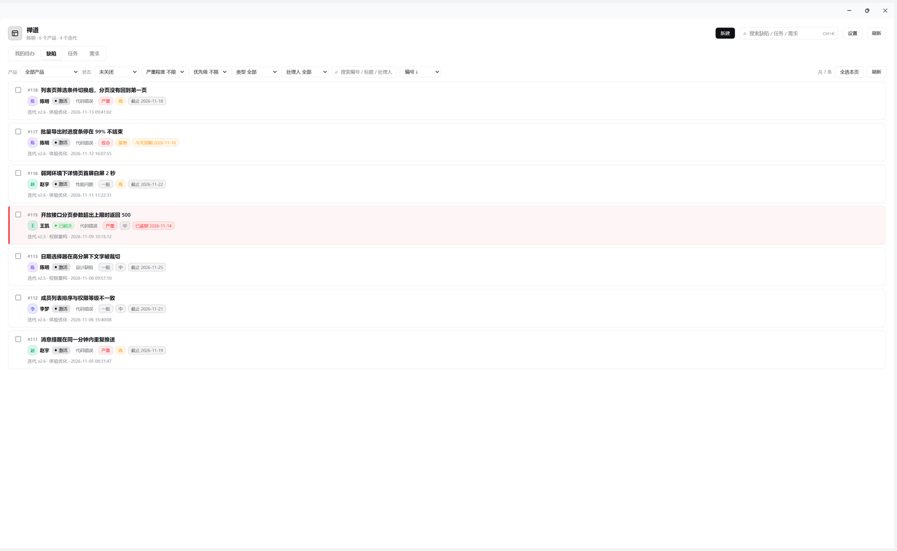
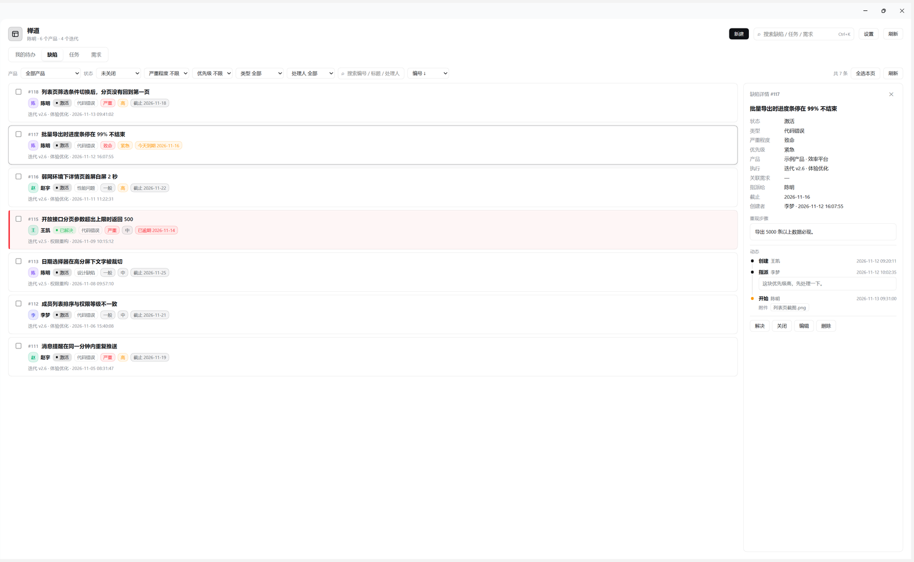
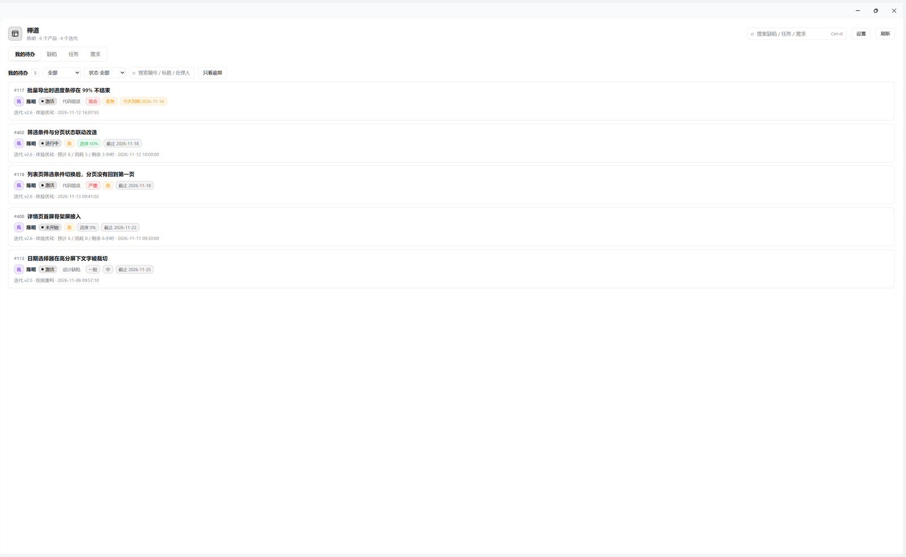
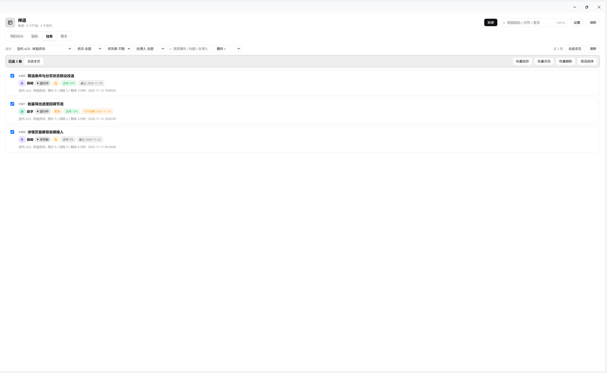

# 禅道面板（dsh-zentao-panel）

[DeepSeek Harness](https://github.com/deepseek-ai) 的禅道面板插件：在 DSH 左侧栏加一个「禅道」入口，把**缺陷看板、我的待办、迭代任务、产品需求**搬进主面板，同时给会话里的模型注册 4 个 `zentao_*` 工具，让 AI 可以直接查和改禅道。

数据全部走禅道官方 OpenAPI v2（`/api.php/v2`），只读展示 + 显式写操作，不修改禅道任何配置。

---

## 界面预览

> 以下截图使用**示例数据**（示例产品、陈明/王凯等虚构人名、示例缺陷编号），与任何真实禅道数据无关。

| 缺陷看板（产品/状态/严重度/优先级/类型/处理人筛选） | 缺陷详情 + 动态时间线 + 操作按钮 |
| --- | --- |
|  |  |

| 我的待办（逾期优先排序） | 任务列表 + 多选批量操作 |
| --- | --- |
|  |  |

---

## 功能

### 面板（四个页签）

| 页签 | 内容 |
|---|---|
| **我的待办** | 指派给我的缺陷 + 任务合并成一张清单，按「逾期 → 到期日 → 优先级」排序，逾期行标红 |
| **缺陷** | 产品维度（支持「全部产品」聚合）、状态下拉、严重度/优先级/类型/处理人/关键词筛选、排序、分页 |
| **任务** | 迭代维度，状态/优先级/处理人/关键词筛选，行内显示进度条、预估-已耗-剩余工时 |
| **需求** | 产品维度（含「全部产品」聚合），状态/阶段/优先级/处理人筛选 |

- **详情抽屉**：字段 + 描述/重现步骤 + **动态时间线**（谁在什么时候做了什么、评论、附件）
- **操作**：缺陷（解决/关闭/激活/编辑/删除）、任务（开始/完成/关闭/激活/编辑/删除）、需求（编辑/变更/关闭/激活/删除）
- **新建**：缺陷 / 任务 / 需求，指派下拉取禅道全量用户
- **批量**：三个列表都支持勾选 + 批量指派 / 批量关闭 / 批量删除（删除二次确认）
- **全局搜索**：`Ctrl/⌘ + K` 搜缺陷/任务/需求，点结果直接跳到对应页签并打开详情

### 会话内工具（注册给模型的）

| 工具 | 用途 |
|---|---|
| `zentao_list` | 列产品/迭代/缺陷/任务/需求，支持产品、迭代、状态、处理人、关键词过滤 |
| `zentao_get` | 取单个缺陷/任务/需求的完整详情 + 动态 |
| `zentao_create` | 新建缺陷/任务/需求 |
| `zentao_act` | 对缺陷/任务/需求执行解决、关闭、激活、开始、完成、变更、指派、删除 |

### 边界（禅道 OpenAPI 本身的限制）

- **没有独立发评论的接口**：评论只能随「解决/关闭/激活/开始/完成/变更」等动作一起提交（动作弹窗里的「备注」）。
- **需求写操作要权限**：`dev` 角色调需求的关闭/变更会被禅道拒绝（`Access not allowed`），换管理员或产品经理账号即可。
- **「其他 / 已关闭的执行」拿不到**：OpenAPI 只返回当前账号「我参与」的执行。

---

## 安装

### 方式一：DSH 面板（推荐）

1. 打开 DSH Web，进入 **插件**（左侧栏）
2. **添加插件** → 选择插件目录（本仓库根目录，即含 `package.json` 的那一层）
3. 左侧栏出现「禅道」入口

### 方式二：命令行

```bash
git clone https://github.com/qq304379685/dsh-zentao-dashboard-x.git
# 然后在 DSH 里用「添加插件」指向 clone 下来的目录
```

插件是纯 ESM JS，**没有构建步骤**（不需要 npm install / tsc / 打包）。

---

## 首次配置

插件**不内置任何账号密码**。第一次打开面板会弹出设置抽屉：

1. **禅道地址**：填到 `api.php/v2` 为止，例如
   `https://zentao.example.com/zentao/api.php/v2`
2. **账号 / 密码**：禅道登录账号
3. 点 **保存并登录** —— 插件会先真登录一次，成功才落盘

配置保存在本机的 profile 数据目录：

```
<DSH_PROFILE_DIR>/data/dsh-zentao-panel/account.json   # 权限 600
```

- 只想浏览时不需要填；401 会自动再弹设置抽屉
- **退出登录** 只清密码，地址和账号保留
- 密码目前是**本机明文**（文件权限 600）。要加密托管可以后续接 DSH 的 `ctx.credentials`

---

## 架构

```
index.js            Host 半边：禅道 API 客户端 + 20 条 /zentao-panel/api/* 路由 + 4 个工具
client.js           Client 半边：侧边栏入口 + 主面板（页签 / 详情 / 批量 / 搜索）
cordis.patch.yml    插件挂载声明
locale/*.json       市场里显示的标题与描述
icon.svg            图标
```

- Host 路由只接受**本机回环**请求（非 loopback 返回 403），token 在 Host 侧持有，不暴露给浏览器
- Client 与 Host 用同源 `fetch('/zentao-panel/api/*')` 通信，无 typert 生成流程
- 登录 token 失效（401）自动重登一次；空响应/异常结构自动重试

## 开发

改 `index.js`（Host）后需要重载插件：DSH 面板 → 插件 → 关闭再打开该插件。
改 `client.js`（Client）只需在主窗口按 `Ctrl+R` 重载渲染进程。

## 许可

MIT，见 [LICENSE](LICENSE)。